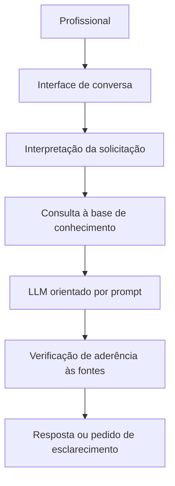

# LogiAssist — Documentação do Agente

## 1. Visão geral

O LogiAssist é um assistente virtual baseado em Inteligência Artificial Generativa, desenvolvido para apoiar profissionais de logística na identificação, classificação e tratamento inicial de ocorrências relacionadas às operações de entrega.

O projeto organiza procedimentos e informações operacionais em uma base de conhecimento para que o usuário consulte orientações de maneira simples e estruturada.

## 2. Caso de uso

### Problema

Equipes de logística e atendimento recebem ocorrências de entrega com informações incompletas, precisam identificar o tipo de problema, verificar quais dados estão faltando e decidir quais procedimentos devem ser seguidos. A falta de padronização pode dificultar a análise e o encaminhamento.

### Solução

O LogiAssist interpreta a descrição apresentada pelo usuário, identifica a categoria provável da ocorrência, consulta a base de conhecimento e sugere verificações e próximos passos. Quando faltarem dados, solicita esclarecimentos em vez de presumir informações.

### Escopo inicial

- Atraso na entrega;
- Rastreamento sem atualização;
- Tentativa de entrega sem sucesso;
- Divergência entre status e situação informada;
- Avaria ou possível extravio;
- Devolução;
- Problemas com endereço de entrega.

### Público-alvo

- Analistas e assistentes de logística;
- Profissionais de SAC e atendimento;
- Equipes de expedição e acompanhamento de pedidos;
- Pequenas e médias empresas que precisam padronizar a triagem de ocorrências.

## 3. Persona e tom de voz

### Nome do agente

LogiAssist — Assistente Inteligente de Operações Logísticas.

### Personalidade

Consultivo, organizado, objetivo e cuidadoso com informações. Atua como apoio à análise, sem substituir a decisão do profissional responsável.

### Tom de comunicação

Profissional, claro e acessível. Evita jargões desnecessários e organiza orientações em etapas práticas.

### Exemplos de linguagem

- Saudação: "Olá! Posso ajudar a classificar uma ocorrência logística ou consultar um procedimento."
- Confirmação: "Entendi. Vou organizar as informações disponíveis e indicar o que precisa ser verificado."
- Informação insuficiente: "Ainda não há dados suficientes para concluir a causa. Você consegue informar a data da última atualização e o prazo previsto?"
- Limitação: "Não tenho acesso ao rastreamento em tempo real. Posso orientar quais informações consultar e como registrar a ocorrência."

## 4. Arquitetura

### Fluxo conceitual

### Componentes

| Componente | Descrição |
|------------|-----------|
| Interface | Protótipo de conversa desenvolvido em Python |
| Modelo de IA | Modelo de linguagem acessado por API ou alternativa local, conforme disponibilidade |
| Base de conhecimento | Arquivos estruturados com categorias de ocorrências, procedimentos e indicadores |
| Prompt de sistema | Instruções de escopo, comportamento, uso das fontes e limites |
| Avaliação | Conjunto de perguntas de teste e critérios de qualidade das respostas |

## 5. Segurança e prevenção de respostas inventadas

O LogiAssist deverá:

- Basear orientações nos documentos disponíveis na base de conhecimento;
- Não inventar prazos, eventos de rastreamento, políticas ou dados de pedidos;
- Não afirmar que uma entrega foi concluída sem evidência fornecida;
- Diferenciar fatos informados pelo usuário de hipóteses e sugestões;
- Solicitar dados complementares quando necessários;
- Informar explicitamente quando a base não contém a resposta;
- Não solicitar nem expor dados pessoais desnecessários;
- Recomendar validação humana antes de decisões operacionais.

## 6. Limitações declaradas

Nesta versão demonstrativa, o agente:

- Não consulta transportadoras nem plataformas de comércio eletrônico em tempo real;
- Não abre chamados nem altera pedidos;
- Não confirma localização, entrega, extravio ou responsabilidade de terceiros;
- Não substitui sistemas de gestão, procedimentos internos ou avaliação do profissional responsável;
- Utiliza dados fictícios e procedimentos de referência, sem representar a política oficial de uma empresa.

## 7. Resultados esperados

Demonstrar como a IA generativa, combinada a uma base de conhecimento organizada, pode apoiar a triagem de ocorrências, padronizar orientações e facilitar a identificação das informações necessárias para a análise logística.

O projeto integra conhecimentos de logística, organização de processos, análise de dados e tecnologia em um protótipo aplicado a uma situação empresarial.
